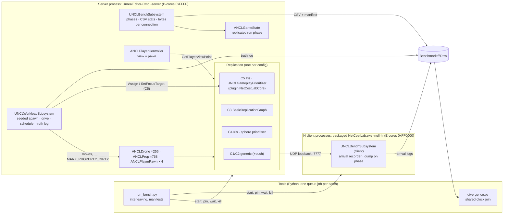

# 02 · System Architecture: NetCostLab (v1.0, final)

**Phase:** 3 (Architecture), **final**, 2026-11-21.
**Engine:** UE 5.8.4. Every engine behaviour relied on here is verified in [01b_Research_Findings.md](01b_Research_Findings.md); references like `01b #3` point to its §1 table.
**Rule:** this is the design *before* code. If implementation proves a decision wrong, this file is updated in the same step.

---

## 1. Goals and non-goals

**Goals**
1. Run **one** server-driven gameplay workload under five replication setups (C1–C5, `01` §6.2) from **one** server binary, switched only by command-line arguments.
2. Measure, the same way in every setup: server net-tick ms per frame, server busy ms per frame, bytes per second per client, and saturation.
3. Measure correctness on the client side: position error and state staleness per drone, split into "threat" (attacking this client's pawn) and "ambient", using one clock shared by all processes.
4. Provide a **reusable, plug-in Iris prioritiser** that adds gameplay relevance ("this object matters to the player it is engaging") on top of Epic's distance model, using only the public Iris API.
5. Run 8, 16 or 32 headless clients plus the server inside one queue job, with the server on the P-cores and the clients on the E-cores.

**Non-goals (v1)**
- A new replication system, filter or serializer. The study uses Epic's systems as shipped.
- Client-side prediction, lag compensation or movement smoothing. Drones are simple replicated actors, so position error measures the replication, not a smoothing filter.
- Dormancy, Mass replication, replays (documented as growth paths, §11).
- Absolute server numbers for a shipping server (impossible on the launcher engine, `01b` #1).

## 2. The core idea in plain words

**The study.** The server spawns everything from a fixed seed and moves it as a pure function of server time. Clients never send gameplay input. Then the only thing that differs between runs is the replication setup, chosen on the command line:

```text
C1  -UseIrisReplication=0  -dpcvars=Net.IsPushModelEnabled=0
C2  -UseIrisReplication=0  -dpcvars=Net.IsPushModelEnabled=1,net.PushModelSkipUndirtiedReplication=1
C3  C2 + -ini:Engine:[/Script/OnlineSubsystemUtils.IpNetDriver]:ReplicationDriverClassName=/Script/ReplicationGraph.BasicReplicationGraph
C4  -UseIrisReplication=1  -dpcvars=Net.IsPushModelEnabled=1
C5  C4 + -NCLPrioritizer=Gameplay
```

**The prioritiser.** Iris asks each prioritiser, once per send and per connection, "how important is each of these objects to this connection?". Epic's sphere prioritiser answers from distance only. Ours, `UNCLGameplayPrioritizer`, **is** the sphere prioritiser (it calls `Super::Prioritize`), and then adds a fixed boost to every object whose *focus target* is this connection's own view target:

```text
priority(object, connection) = sphere(distance(object, view))                      // Epic's model, unchanged
                             + FocusPriorityBoost   if focus(object) == view target(connection)
```

A drone's focus target is the pawn it attacks. So a drone shooting at player 7 is urgent for player 7 only; everyone else sees it at its normal distance priority. This is the same shape as Epic's `USphereWithOwnerBoostNetObjectPrioritizer` (distance + `OwnerPriorityBoost` for the owning connection, `01b` #8), with "owner" replaced by a gameplay relation that the game updates at run time.

**Why a boost and not a multiplier or a separate model:**

| Alternative | Why we rejected it |
|---|---|
| Multiply the sphere priority | A far drone has priority 0.1; doubling it is still below 1.0, the threshold at which Iris even considers an object (`01b` §3), so a multiplier cannot rescue far threats |
| A new distance model | Then C4 → C5 would change two things at once (the model and the gameplay term). Reusing `Super::Prioritize` keeps C5 = C4 + one term |
| A static priority per drone (`SetStaticPriority`) | Connection-agnostic: it would make the drone urgent for every player, not only for its target |
| Switching drones between two prioritiser instances | Also connection-agnostic |

## 3. Modules and where they live

```text
D:\UNREAL PORTFOLIO\P05_NetCostLab\NetCostLab\               ← the UE project
├── NetCostLab.uproject                                      (plugins on: Iris, ReplicationGraph, NetCostLabCore; off: AndroidFileServer)
├── Source\NetCostLab\{Public,Private}\                      ← game module: workload + benchmark harness only
├── Source\NetCostLab.Target.cs, NetCostLabEditor.Target.cs
├── Plugins\NetCostLabCore\Source\NetCostLabCore\{Public,Private}\   ← the reusable prioritiser
└── Config\  Content\
D:\UNREAL PORTFOLIO\P05_NetCostLab\Tools\                    ← Python: run orchestration, CSV stats, divergence analysis
```

| Module | Type | Responsibility | Depends on |
|---|---|---|---|
| `NetCostLabCore` (plugin) | Runtime | The gameplay-aware Iris prioritiser and its config | `Core`, `CoreUObject`, `Engine`, `NetCore`, `IrisCore` (via `SetupIrisSupport`) |
| `NetCostLab` (primary game module) | Runtime | Game mode, pawns, drones, props, workload driver, benchmark director, telemetry | `Core`, `CoreUObject`, `Engine`, `NetCore`, `IrisCore`, `NetCostLabCore` |
| `Tools\` | Python | Launch server + clients pinned to cores (one queue job per batch), interleaving, manifests, CSV statistics, the offline position-error and staleness join | — |

**The dependency rule:** game → plugin, never the reverse. The plugin knows nothing about drones or benchmarks; it only knows "objects", "focus targets" and "views".

**Naming:** module names must be unique ([research/04](Research/04_local_engine_verification.md) §0), hence `NetCostLabCore` for the plugin and `NetCostLab` for the game. Class prefix `NCL`. Public headers use 5.8's `#define UE_API <MODULE>_API … #undef UE_API` export pattern (P01 `01b` §3).

## 4. Classes

### 4.1 Plugin `NetCostLabCore` (2 classes)

| Class | Kind / base | Responsibility | Why it exists, and what we rejected |
|---|---|---|---|
| `UNCLGameplayPrioritizerConfig` | `UCLASS(Transient, Config=Engine)` : `USphereNetObjectPrioritizerConfig` | The sphere settings it inherits, plus `UPROPERTY(Config) float FocusPriorityBoost = 2.0f` | The sphere `Init` requires a `USphereNetObjectPrioritizerConfig` (`CastChecked`, `01b` #8). Deriving keeps every distance setting identical to C4's default |
| `UNCLGameplayPrioritizer` | `UCLASS(Transient)` : `USphereNetObjectPrioritizer` | Overrides `Init`, `Deinit`, `OnMaxInternalNetRefIndexIncreased`, `AddObject`, `RemoveObject`, `Prioritize`. Public API for server game code: `bool Assign(UReplicationSystem&, FNetObjectPrioritizerHandle Self, FNetRefHandle)`, `bool SetFocusTarget(FNetRefHandle Object, FNetHandle Target)`, `ClearFocusTarget`, counters | *Rejected:* subclassing `UNetObjectPrioritizer` directly (would re-implement the distance model and change two factors); reading game data through private Iris headers like the owner-boost prioritiser does (not public API, not exported, `01b` #7); custom rep tags (test-only in 5.8, `01b` #7) |

**How the prioritiser learns which object is which (the identity problem, `01b` #7).** `AddObject` and `Prioritize` see only Iris's internal object index, never the actor or its `FNetRefHandle`, and no public API converts between them for prioritisers. But `UReplicationSystem::SetPrioritizer(Handle, PrioritizerHandle)` calls our `AddObject` **synchronously, inside the same call**. So:

```cpp
// Game code, once per world: Self = System.GetPrioritizerHandle(TEXT("NCLGameplayPrioritizer")); (the definition's name)
bool UNCLGameplayPrioritizer::Assign(UReplicationSystem& System, FNetObjectPrioritizerHandle Self, FNetRefHandle Handle)
{
    CapturedIndex = InvalidIndex;  bCapturing = true;            // AddObject records the index it is called with
    const bool bSet = System.SetPrioritizer(Handle, Self);        // public API; calls AddObject synchronously (5.8.4)
    bCapturing = false;
    if (!bSet || CapturedIndex == InvalidIndex) { ++AssignFailures; return false; }   // never boost on a guess
    HandleByIndex[CapturedIndex] = Handle;  IndexByHandle.Add(Handle, CapturedIndex);
    return true;
}
```

The prioritiser's handle comes from game code because the prioritiser cannot know it: Iris names each instance with `MakeUniqueObjectName(…, Definition.PrioritizerName)` and keeps the definition name separately (`ReplicationPrioritization.cpp:903–923`), so the object's own name may carry a suffix. The same lines show that each prioritiser gets its **own** config object, created from the config class, whose defaults come from the class's `Config=Engine` section; that is how `FocusPriorityBoost` is set from `DefaultEngine.ini`.

The game later calls `SetFocusTarget(Handle, TargetNetHandle)` only when gameplay changes (a map lookup, not per frame). `Prioritize` reads a dense `TArray<FNetHandle> FocusByIndex`. If a future engine version makes `AddObject` deferred, `Assign` fails loudly (counter + error log) and the object keeps plain sphere priority, so C5 silently becoming C4 is impossible to miss.

**Telemetry:** a CSV category `NCLPrioritizer` with `BoostedPerFrame` and `AssignFailures`, published once per frame by the game's bench subsystem (not from inside `Prioritize`, which runs per connection).

### 4.2 Game module `NetCostLab` (8 classes)

| Class | Base | Responsibility |
|---|---|---|
| `ANCLGameMode` | `AGameModeBase` | Sets the pawn, controller and game-state classes; nothing else |
| `ANCLGameState` | `AGameStateBase` | Replicates the run phase (`ENCLBenchPhase`: Waiting, WarmUp, Capture, Settle, Dump) so headless clients know when to start and stop logging and when to write their files and quit |
| `ANCLPlayerController` | `APlayerController` | Overrides `GetPlayerViewPoint` to return the possessed pawn's location on the server, so the view used by every system is server-determined and identical (`01b` #12) |
| `ANCLPlayerPawn` | `APawn` | A replicated pawn with no movement component. The server moves it on its seeded loop. Holds its `PlayerSlot` |
| `ANCLDrone` | `AActor` | Replicated movement plus push-based gameplay fields (`State` struct: `Seq`, `Mode`, `TargetSlot`, `Health`; four loadout fields). On clients, overrides `OnRep_ReplicatedMovement` and `OnRep_State` to record arrivals into the client recorder |
| `ANCLProp` | `AActor` | Stationary; four push-based fields that toggle on a seeded schedule |
| `UNCLWorkloadSubsystem` | `UTickableWorldSubsystem` (server only) | Seeded spawn; each frame moves drones and pawns as a function of server time, applies the change schedule (calling `MARK_PROPERTY_DIRTY_FROM_NAME`), records server truth; computes the workload hash; in C5 assigns drones to the prioritiser (retrying until each has an Iris handle) and updates focus targets when a drone retargets |
| `UNCLBenchSubsystem` | `UTickableWorldSubsystem` (server and client) | The director. Reads `-NCL…=` arguments; server: waits for N clients, warm-up, `CSV_EVENT(BenchStart)`, capture, settle, dump, exit; samples per-connection `OutTotalBytes` and busy ms at `FWorldDelegates::OnWorldTickEnd` (after the net flush, `01b` #10) and publishes CSV stats; client: event recorder, frame-rate check, dumps on `Dump`, exits |

**Why a world subsystem for the workload and the director:** the project has no hand-authored map (an engine template map, as in P01), so nothing would place a manager actor; a world subsystem has exactly the world's lifetime. **Why two subsystems:** the workload is server-only and is the same in every configuration; the director also runs on clients and owns measurement. Keeping them apart means the measuring code cannot change the workload.

**Why the drone state is one struct (`FNCLDroneState`):** `Seq` increments on every gameplay change, so the client can tell exactly which server change it is seeing; one struct keeps `Seq`, `Mode`, `TargetSlot` and `Health` consistent with each other. The four loadout fields stay separate properties on purpose: they are what makes the push-model comparison meaningful (legacy compares each one at every update, push skips them, H1).

**Why `TargetSlot` (an `int8`) and not a pawn pointer:** an object reference adds NetGUID resolution on the client and differs between systems; a slot index is plain data. The server maps slot → pawn → `FNetHandle` for the prioritiser.

## 5. Overview diagram



## 6. Per-tick flow (server, one frame at 30 Hz)

```mermaid
sequenceDiagram
  participant W as UWorld::Tick
  participant WL as UNCLWorkloadSubsystem
  participant BS as UNCLBenchSubsystem
  participant ND as UNetDriver::TickFlush
  participant GP as UNCLGameplayPrioritizer (C5)
  W->>W: NetworkIncoming (TickDispatch)
  W->>WL: Tick (after PostPhysics)
  WL->>WL: move drones + pawns to f(server time); apply schedule; MARK_PROPERTY_DIRTY
  WL->>GP: SetFocusTarget for drones that retargeted (C5 only)
  W->>BS: Tick: phase control, CSV_EVENT(BenchStart) when due
  W->>ND: TickFlush [CSV: NetworkOutgoing]
  ND->>ND: ServerReplicateActors [CSV: ServerReplicateActors]
  Note over ND: legacy/graph: consider, compare, prioritise, serialise<br/>Iris: views, poll/copy, filter, prioritise, write
  ND->>GP: Prioritize(batch, connection, view): Super::Prioritize then + boost
  ND->>ND: connection ticks: send packets, refill bandwidth
  W->>BS: OnWorldTickEnd: per-connection bytes this frame, busy ms of last frame
  W->>W: idle sleep to 33.3 ms (FApp idle time)
```

### The prioritiser's `Prioritize`, in code-sized pseudocode (the real code mirrors this)

```text
Super::Prioritize(Params)                                  // Epic's sphere model writes Priorities[idx]
for k in 0 .. Params.ObjectCount-1:
    idx = Params.ObjectIndices[k]
    focus = FocusByIndex[idx]
    if focus is valid:
        for view in Params.View.Views:                     // one view per connection here (no split screen)
            if view.ViewTarget == focus or view.Controller == focus:
                Params.Priorities[idx] += FocusPriorityBoost
                ++BoostedThisFrame
                break
```

The loop after `Super::Prioritize` is a **static, pure function** (`ApplyFocusBoost(ObjectIndices, Count, Priorities, FocusByIndex, View, Boost)`) so automation tests can check it with fake arrays, without a replication system (`03`, S6).

Cost: one array read per prioritised object per connection, plus a compare per view. At 256 drones × 32 connections that is about 8,000 cheap iterations per send. SC6 measures it.

## 7. Defaults and why

| Setting | Default | Reasoning |
|---|---|---|
| Drones / props | 256 / 768 | About 1,000 replicated actors: enough that per-connection work dominates at 32 clients, small enough that 32 uncapped clients fit on loopback. Fixed before the baselines; never changed afterwards |
| Drone / pawn / prop `NetUpdateFrequency` | 30 / 30 / 5 Hz | Drones and pawns move every server tick; props change rarely. A competent setup, not a strawman (the hon454 lab showed what a 100 Hz default costs) |
| Cull distance | 150 m (engine default, `Actor.cpp:312`) | The same number in every system (`01b` #11) |
| Server tick | 30 Hz (`NetServerMaxTickRate`) | The engine default for dedicated servers |
| `FocusPriorityBoost` | 2.0 | The same value Epic chose for `OwnerPriorityBoost` (`SphereWithOwnerBoostNetObjectPrioritizer.h:17`). It lifts a far threat (0.1) above the 1.0 consideration threshold. Phase 8 sweeps 1, 2 and 4 |
| Sphere settings for C4 and C5 | Engine defaults (inner 2,000, outer 10,000, priorities 1.0 / 0.2 / 0.1) | C5 must differ from C4 in the boost only |
| Scenario A cap | 1,000,000 B/s per client (client request, server max, server internet max) | A rough estimate of per-client demand is 256 drones × 30 Hz × 15–30 B ≈ 115–230 kB/s (an estimate, not a measurement), so the cap is 4–8× above it: uncapped for practical purposes. SC2 checks it on every run; S4 measures the real demand |
| Scenario B cap | 24,000 B/s per client | About 10–20% of that estimated demand, so prioritisation decides what is sent. Calibrated once on C4 in S4 (≥ 90% saturated frames), then frozen |
| Warm-up / capture / settle | 20 s / 60 s (1,800 frames) / 5 s | Warm-up covers join bursts and initial replication; settle lets every final change arrive before the state dump (SC7) |
| Client frame cap | 30 fps (`t.MaxFPS 30`) | Bounds client CPU so 32 clients fit on the 8 E-cores; matches the server rate |
| Affinity | server `0xFFFF`, clients `0xFF0000` | The measured process gets the P-cores; recorded per run |
| Client binary | The packaged Development game, `-nullrhi` | Decided by Phase 4 check F4: it joins the editor-binary server in both systems, at ≈ 0.35–0.54 GB per process against ≈ 1.7 GB for an editor-binary client, so 32 clients fit in memory (`09` F-4, P2-1e). The server stays the editor binary |
| Registered sub-object lists | `net.SubObjects.DefaultUseSubObjectReplicationList=1` (`DefaultEngine.ini`) | Iris requires it (`09` P2-1d); set for every configuration so the workload stays identical (`05` A7) |

## 8. Lifetime and safety rules

| Risk | Rule | Evidence |
|---|---|---|
| Subsystems run in editor worlds | `DoesSupportWorldType`: Game and PIE only; the workload subsystem also requires authority (`NM_DedicatedServer` or `NM_ListenServer`) | P01 `01b` #2 |
| The prioritiser is used after Iris shut it down | `Deinit` clears every array and map and sets `SelfHandle` invalid; the game fetches the prioritiser by name each time it needs it (`GetPrioritizer`), never caches it across worlds | `NetObjectPrioritizer.h:171–172` ("Use this to remove references to other systems") |
| Iris grows its object index space at run time | All per-index arrays are sized from `CurrentMaxInternalIndex` in `Init` and grown in `OnMaxInternalNetRefIndexIncreased` (call `Super` first) | `NetObjectPrioritizer.h:110–111, 175` |
| An internal index is reused by another object | `RemoveObject` clears `FocusByIndex`, `HandleByIndex` and the map entry; `SetFocusTarget` looks up by `FNetRefHandle`, so a stale handle finds nothing | `ReplicationPrioritization.cpp:656–680` (removal on scope exit) |
| `AddObject` is not synchronous in some engine version | `Assign` checks the captured index and refuses to guess (counted, logged) | `01b` #7 |
| A drone has no Iris handle yet when spawned | Assignment is retried each frame from a pending list until `GetReplicatedRefHandle` is valid | `Actor.cpp:4768` (`StartReplicatingActor` in `DispatchBeginPlay`), `ReplicationSystemUtil.h:203` (a deferred variant exists) |
| A focus target (pawn) is destroyed | Its `FNetHandle` just stops matching any view; the game clears focus when a player leaves | `ReplicationView.h:23–25` |
| Per-event logging allocates during the capture | Client and server recorders `Reserve` their arrays before `BenchStart`; files are written only in `Dump` | Measurement hygiene (`01` §4) |
| Logging cost differs between configurations | Recording is the same code in every configuration; Scenario A turns client recording off entirely (`-NCLLog=0`) | `01` §6.4 |
| `CSV_CUSTOM_STAT` per object would distort timing | All counters are plain fields published once per frame | P01 measured ~50 ns per custom stat |

## 9. One workload for every configuration

| Config | What changes | Set by |
|---|---|---|
| C1 | Nothing in our code | `-UseIrisReplication=0 -dpcvars=Net.IsPushModelEnabled=0` |
| C2 | Push dirtiness and skipping of clean replicators | `-dpcvars=Net.IsPushModelEnabled=1,net.PushModelSkipUndirtiedReplication=1` |
| C3 | The replication driver | `-ini:Engine:[/Script/OnlineSubsystemUtils.IpNetDriver]:ReplicationDriverClassName=/Script/ReplicationGraph.BasicReplicationGraph` (+ C2's cvars) |
| C4 | The replication system | `-UseIrisReplication=1` on server **and** clients (+ push on) |
| C5 | Drones are assigned to our prioritiser | C4 + `-NCLPrioritizer=Gameplay` (server only) |

Our game code calls `MARK_PROPERTY_DIRTY_FROM_NAME` after every change in **every** configuration; when push is off the call does nothing useful, and its cost is identical everywhere. The prioritiser is registered in `DefaultEngine.ini` in every configuration; with no objects assigned it costs nothing per frame: `PrePrioritize` is skipped when its `ObjectCount == 0` (`ReplicationPrioritization.cpp:555–567`), and `Prioritize` is only called with batches that contain its own objects (`:760–800`).

## 10. C++ vs Blueprint

| C++ | Blueprint |
|---|---|
| Everything: workload, director, telemetry, prioritiser | Nothing. Blueprint VM cost and Blueprint-replicated properties (`Net.MakeBpPropertiesPushModel`) would add a variable the study does not need |

## 11. How it grows into a production game (not built now)

- **Threat lists, not one focus target:** a small fixed array of focus handles per object (a sniper and its spotter), or a per-connection boost table filled by the AI system.
- **Other gameplay relations:** squad members, objective carriers, recent damage sources. All fit "object → set of views it matters to".
- **Combine with field of view:** chain our boost after `UFieldOfViewNetObjectPrioritizer` instead of the sphere; the boost code does not depend on the base model.
- **Dormancy and Mass:** dormant props, and Iris for Mass once Epic ships it (not in 5.8, [research/03](Research/03_existing_solutions_gap_analysis.md) §3).
- **A real Server target:** on a source-built engine, add `NetCostLabServer.Target.cs` back and repeat the study with a shipping-like server to get absolute numbers.
- **Remove the synchronous-`AddObject` dependency:** ask Epic for a public "internal index for handle" accessor on prioritisers (filters already have one, protected).
- **Legacy equivalent for comparison:** an `AActor::GetNetPriority` override with the same focus rule (a possible sixth configuration, listed as an owner decision in the Phase 4 report).

## 12. Known limits (stated, not hidden)

1. **Editor-build server.** Absolute ms include editor-only overhead; only comparisons between configurations are claimed.
2. **One PC.** Clients share memory bandwidth, caches and thermals with the server even when pinned to other cores.
3. **Out-of-the-box Replication Graph.** `UBasicReplicationGraph` is Epic's example; a tuned graph could beat it.
4. **One view per connection.** Split-screen views are handled by the loop but not tested.
5. **The boost is additive and unconditional.** A drone with a focus target is boosted even if it is behind a wall; line of sight is a growth path.
6. **The server-driven pawns are not real players.** No client input means no server move RPCs, which real games pay for. That cost is the same in every configuration, so it is excluded on purpose.
7. **No movement smoothing on clients.** Position error is larger than what players would see with interpolation; it measures replication freshness, which is the point.

## 13. Changes from the plan (README, 2026-11-20 → 2026-11-21)

| Change | Why |
|---|---|
| Server = editor binary with `-server`, not a dedicated-server target | The launcher engine cannot build Server targets (`01b` #1) |
| C2 (push model) runs only in the editor binary | Packaged games on the launcher engine have no push model (`01b` #2) |
| Real time instead of a fixed step | A fixed-step server would run faster than real time (`01b` #4) |
| Gap restated: the comparison is a re-measurement; the prioritiser and correctness are the new part | Phase 2 found a 5.8.3 lab that already compares legacy/Replication Graph/Iris with bandwidth (`01b` §5) |
| The prioritiser derives from the sphere prioritiser and adds a boost | One changed factor between C4 and C5; reuses Epic's exported code (`01b` #8) |
| Prioritiser identity via synchronous `SetPrioritizer` → `AddObject` | No public index↔handle mapping exists for prioritisers (`01b` #7) |
| Server-determined view (`GetPlayerViewPoint` override) | All systems read the view from the camera cache otherwise (`01b` #12) |
| Shared QPC clock instead of time synchronisation | All processes are on one PC (`01b` #13) |
| Clients = packaged game; sub-object lists on for every configuration (Phase 4) | Check F4 and probe P2-1 (`09`) |
