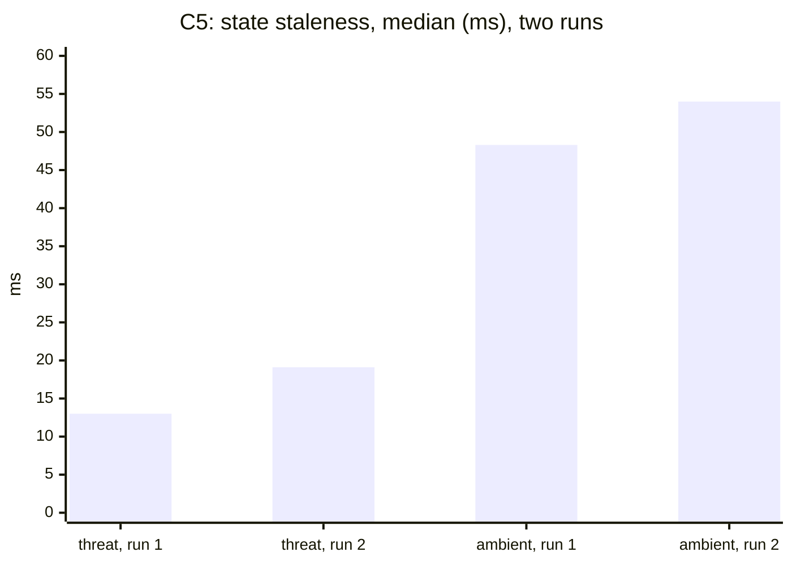
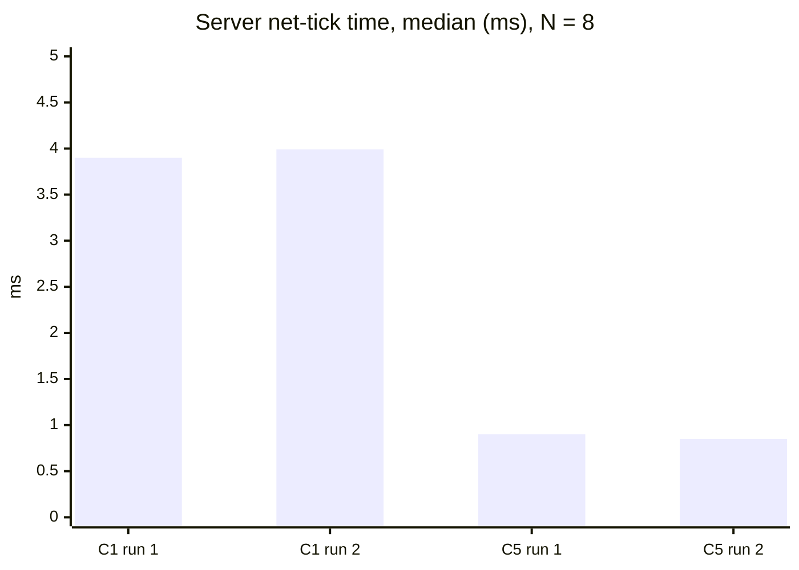

# P05 · NetCostLab: replication cost and a gameplay-aware prioritiser

**Author:** Krish Gangani · [github.com/KrishGangani](https://github.com/KrishGangani)

**Domain:** Multiplayer & network optimisation · **Difficulty:** ★★★★☆ · **Engine:** UE 5.8.4

> **Status: v1.0, smallest working form (2026-11-21).** The workload, the measurement harness, the correctness tools, C6 and the gameplay-aware Iris prioritiser (C5) are built, tested and running. The planned benchmark campaign (N = 16/32, the bandwidth cap, packet loss, all six configurations) was **not run** (owner direction). The numbers below come from 8-client runs only, and every success criterion that needs the campaign is marked *not measured* ([09](Explanation/09_Testing_And_Benchmarks.md#success-criteria-01-65-from-the-data-that-exists)).

| Phase | 1 Problem | 2 Research | 3 Architecture | 4 Foundation | 5 Implementation | 6 Explanation | 7 Testing | 8 Profiling | 9 Review | 10 Portfolio |
|---|---|---|---|---|---|---|---|---|---|---|
| State | ✓ | ✓ | ✓ final | ✓ core done (S1–S3, S5–S7 code; no S4/S5 campaign, no S8) | ✓ | ✓ tools validated (S3) | campaign not run | S1–S3 reviewed | — |

---

## Problem statement

A multiplayer server sends every replicated actor to every connection, so its CPU time and bandwidth grow with **connections × actors**, not with what changed or what matters to each player. Unreal ships four answers (push model, Replication Graph, Iris and their prioritisers), but there are few like-for-like measurements, and when bandwidth runs out Iris's shipped prioritisers decide by **distance only**. Details: [Explanation/01_Problem_Analysis.md](Explanation/01_Problem_Analysis.md).

## Engineering approach

One server-driven gameplay workload (256 drones, 768 props, 8/16/32 headless clients on one PC), run under six configurations from **one** server binary:

| ID | Configuration |
|---|---|
| C1 | Generic (legacy) replication |
| C2 | C1 + push model (`MARK_PROPERTY_DIRTY_FROM_NAME`) |
| C3 | C2 + Replication Graph (`UBasicReplicationGraph`) |
| C4 | Iris with its default sphere prioritiser |
| C5 | Iris + our **gameplay-aware prioritiser**: Epic's sphere model plus a boost, for one connection only, for drones that are attacking that connection's player |
| C6 | C2 + the same focus rule in the legacy `AActor::GetNetPriority` hook: the fair existing-solution comparison for C5 |

Measured: server ms per net tick, bytes/s per client, scaling slopes over 8/16/32 clients, and correctness (position error, state staleness, final mismatches) under a bandwidth cap and 0/1/3/5% emulated loss, on a clock shared by all processes. Details: [Explanation/02_System_Architecture.md](Explanation/02_System_Architecture.md).

**What Phase 2 changed (honestly):**
- **The launcher engine cannot build a dedicated-server target, and its packaged games have no push model.** The server is therefore the editor binary in `-server` mode for every configuration; only comparisons, not absolute server numbers, are claimed ([01b](Explanation/01b_Research_Findings.md) #1–#3).
- **The comparison itself is not new:** a public UE 5.8.3 lab already compares legacy, Replication Graph and Iris with bandwidth at 8 clients, and gameplay-weighted priority has long been possible in legacy through `AActor::GetNetPriority`. The new part is a gameplay-aware **Iris** prioritiser, push model as an isolated factor, scaling slopes, and correctness under loss ([01b](Explanation/01b_Research_Findings.md) §5).

## Architecture diagram

Final (v1.0): [Explanation/02_System_Architecture.md](Explanation/02_System_Architecture.md) §5–6 (mermaid).

## Before / after comparison

**What the gameplay prioritiser does (C5, N = 8, two runs).** A drone that is attacking a player gets a priority boost for that player's connection only. Its state changes then reach that player about **three times sooner** than other drones' changes. Median staleness from server change to client arrival, two runs of C5:

Position error on the attacked player's screen: p50 7–10 cm for threat drones vs 24–26 cm for ambient drones; p95 31–33 cm vs 136–137 cm. Every run ended with **0 final-state mismatches** and 256 of 256 drones assigned to the prioritiser with 0 failures ([09](Explanation/09_Testing_And_Benchmarks.md), batch `2026-11-21_110518_finalb`).

**What this is not:** the planned proof compares C5 with C4 (Iris without our term) under a bandwidth cap, where priority decides what gets sent at all. That comparison (SC4/SC5) was not run.

## Benchmark results

8 headless clients, 1 MB/s per client (uncapped), 256 drones + 768 props, server pinned to the P-cores and clients to the E-cores. Each value is one run's median over a 30 s window (900 server frames); the two runs per configuration were interleaved (C1, C5, C5, C1) after a discarded priming run:

| Metric | C1 legacy | C5 Iris + gameplay prioritiser |
|---|---|---|
| Server net-tick time, median | 3.90 / 3.99 ms | **0.90 / 0.85 ms** |
| Server net-tick time, p95 | 4.97 / 5.72 ms | 1.48 / 1.20 ms |
| Bytes/s per client, median | 67,073 / 67,101 | 43,060 / 43,044 |
| Threat-drone staleness, median | 38.5 / 37.9 ms | **13.0 / 19.1 ms** |
| Ambient-drone staleness, median (p95) | 36.8 / 37.6 ms (67 ms) | 48.3 / 54.0 ms (305 ms) |

How to read this honestly:
- **C1 vs C5 changes two things at once**: Iris and our term. Iris alone (C4, measured in steps S2/S3 under the same conditions) ran at 0.86–0.88 ms and 43.6 kB/s per client, so the CPU and bandwidth gap to C1 comes from Iris, not from the prioritiser. Iris's distance model also spreads far drones out in time (ambient p95 about 300 ms in both C4 and C5).
- The server is the editor binary (the launcher engine has no Server target), so only comparisons are meaningful.
- Not measured: N = 16/32, scaling slopes, the bandwidth cap, packet loss, C2/C3/C6 runs (SC3–SC8). The tools for all of these exist (`Tools/run_bench.py`, `Tools/divergence.py`).

The measurement tools were checked before use: 100 ms of added server lag raised both measured staleness and position age by 117 ms. That is the lag plus the wait for the next 33 ms connection tick, where the engine releases a lagged packet ([09](Explanation/09_Testing_And_Benchmarks.md) S3-c).

Raw data: [Benchmarks/](Benchmarks/README.md). The pass/fail criteria were fixed in advance: [01_Problem_Analysis.md §6.5](Explanation/01_Problem_Analysis.md).

## Recorded demonstration

Not made (owner direction: no video).

## Source code

The UE project is in [NetCostLab/](NetCostLab/) (UE 5.8.4, C++):
- the reusable system is the plugin `NetCostLabCore` (the gameplay-aware Iris prioritiser, from step S6);
- the workload and the benchmark harness are in the game module `NetCostLab` (from step S1);
- run and analysis scripts are in [Tools/](Tools/).

## Documentation

| File | Contents |
|---|---|
| [00_Project_Overview](Explanation/00_Project_Overview.md) | Identity, demonstration, presentation, industry relevance |
| [01_Problem_Analysis](Explanation/01_Problem_Analysis.md) | Problem, existing work, root-cause hypotheses, workload, configurations, metrics, success criteria, measurement plan |
| [01b_Research_Findings](Explanation/01b_Research_Findings.md) | Phase 2: verified engine behaviour (UE 5.8.4), the launcher-engine limits, existing work, and what they changed |
| [02_System_Architecture](Explanation/02_System_Architecture.md) | Final v1.0: modules, classes, the prioritiser, data flow, per-tick flow, defaults, safety rules, rejected alternatives |
| [03_Implementation_Roadmap](Explanation/03_Implementation_Roadmap.md) | The small, ordered build steps; baselines captured before the prioritiser exists |
| [04](Explanation/04_CPP_Fundamentals.md) · [05](Explanation/05_Line_By_Line_Code_Explanation.md) · [06](Explanation/06_Unreal_APIs_And_Macros.md) · [07](Explanation/07_Common_Mistakes.md) | C++ fundamentals, line-by-line code, APIs and macros, common mistakes. Written step by step with the code (current to Phase 4) |
| [09](Explanation/09_Testing_And_Benchmarks.md) | Every check so far, with its command and result |
| [08](Explanation/08_Debugging_And_Profiling.md) · [10](Explanation/10_Interview_Questions.md) · [11](Explanation/11_Optimization_Decisions.md) · [12](Explanation/12_Future_Scalability.md) | Debugging and profiling, interview questions, optimisation decisions, future scalability. Filled in during Phases 5–10 |
| [Phase2_Raw_Notes/](Explanation/Phase2_Raw_Notes/README.md) | The audit trail behind `01b` |
| [Research/](Explanation/Research/) | The portfolio-wide research this project draws on: job market, technical challenges, existing solutions, local engine verification |

## Why studios care

Riot: "bandwidth optimization, server density". Epic: "network replication systems (client-server prediction, state synchronization, lag compensation)". Fortnite BR's 100-player server work and Respawn's Apex netcode write-up ([research/02](Explanation/Research/02_technical_challenges.md) [T3-A], [T3-G]).

## License

MIT, see [LICENSE](LICENSE). Unreal Engine itself is not included and is covered by Epic Games' own license.
